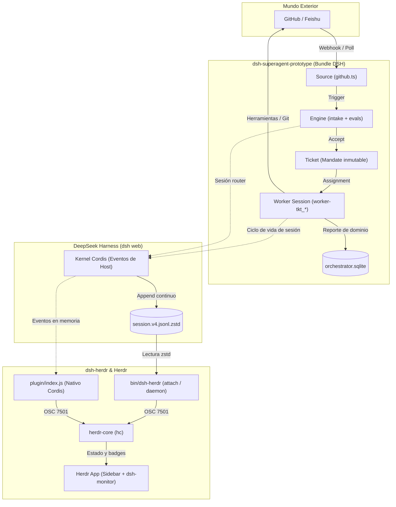

# 01 · DSH: panorama general y ecosistema

Esta página ofrece una visión de conjunto del ecosistema de **DeepSeek Harness (`dsh`)**, articulando qué es el host visto desde fuera, cómo encaja el prototipo de superagente proactivo (`dsh-superagent-prototype`) y cómo el puente de telemetría `dsh-herdr` permite monitorizar dicho host en la aplicación de terminal Herdr.

!!! info "Síntesis de análisis independiente (2026-11-08)"
    Consolidación de tres análisis independientes de solo lectura (Codex, Sonnet y agy) sobre los commits fijados `deepseek-ai/dsh-superagent-prototype@8c32a9dc` (MIT) y `mitkox/dsh-herdr@2d74cf86` (Apache-2.0). Ningún analista ejecutó un host DSH en vivo ni existe `~/.dsh` en el entorno; las conclusiones proceden de lectura estática del código, configuraciones y evidencias de pruebas.

---

## 1. Qué es DeepSeek Harness (DSH) visto desde fuera

El código fuente central de DSH no se distribuye de forma abierta en ninguno de los dos repositorios; todo lo que se conoce de su arquitectura se revela a través de los contratos de sus extensiones y plugins:

1. **Host sin TUI nativa**: En su rama 0.2.x (`package.json:55`, `engines.dsh: ^0.2.1-alpha.2`), DSH es un proceso Node.js que ejecuta un servidor web local (`dsh web`, típicamente en `http://127.0.0.1:3080`). No cuenta con interfaz interactiva en terminal; para el sistema operativo o para Herdr, el host es simplemente un proceso `node` ordinario sin estados visibles (`dsh-herdr/README.md:20-22`).
2. **Microkernel modular sobre Cordis**: DSH utiliza **Cordis** (`@deepseek-ai/cordis` 4.0.5), el contenedor de inyección de dependencias y plugins del ecosistema Koishi. La configuración del host y de sus agentes se define mediante parches declarativos YAML (`cordis.patch.yml`) que insertan plugins, herramientas y presets dentro de un perfil (`profile`).
3. **Servicios expuestos a los plugins**: Al registrar un bundle (`src/index.ts:7-10`), DSH proporciona acceso a una amplia suite de primitivas:
   - `sessionController`: Creación, resolución, nombrado y aborto de sesiones de agentes.
   - `agents`: Gestión del ciclo de vida y enumeración (`agents.list()`).
   - `workspaceRegistry`: Creación y control de directorios de trabajo aislados en disco.
   - `permissionPresets`: Niveles de seguridad y autorización de herramientas (ej. `danger-full-access`).
   - `tools` y `skills`: Registro dinámico de herramientas mediante esquemas Zod y carga de habilidades desde el sistema de archivos.
   - `webServer`: Registro de rutas HTTP y WebSockets propios en el puerto web del host.
   - `subprocess` y `llm`: Ejecución de procesos en el sistema y abstracción del catálogo de modelos.
4. **Persistencia mediante Journals Append-Only**: DSH almacena cada evento de cada sesión (inicio y fin de turnos, llamadas a herramientas, mensajes de usuario y asistente, solicitudes de aprobación) en archivos persistentes en disco:
   ```
   ~/.dsh/sessions/<cwd-slug>/<session-id>/session.v4.jsonl.zstd
   ```
   Cada archivo es un JSON Lines comprimido en bloques continuos Zstandard. El propio repositorio `dsh-herdr` advierte en `docs/COMPATIBILITY.md` que este archivo es un formato interno de almacenamiento y no una API pública estable.

---

## 2. Los dos actores del ecosistema

Alrededor de DSH conviven dos proyectos con propósitos completamente independientes:

- **`dsh-superagent-prototype`** (desarrollado por DeepSeek):  
  Es un *bundle* oficial de investigación. Escucha eventos procedentes de GitHub (issues, PRs, revisiones) o Feishu. Aplica una política de admisión estricta, genera un **Ticket** de trabajo con un **Mandato** inmutable y asigna la ejecución a una sesión de DSH (`worker-<ticketId>`) que opera en un subdirectorio aislado (`worktree`). Cuando concluye, publica un PR o responde en el hilo de origen.

- **`dsh-herdr`** (desarrollado por mitkox):  
  Es un monitor pasivo y externo. Como `dsh web` carece de interfaz de terminal y no reporta estados al exterior, `dsh-herdr` inspecciona los journals de DSH en disco (o escucha eventos internos mediante un plugin opcional), deduce si el sistema está trabajando (`working`), desocupado (`idle`) o esperando al operador (`blocked`), y emite secuencias de escape **OSC 7501** en la terminal de Herdr. Esto permite que el host aparezca en la barra lateral de Herdr con icono, nombre oficial y alertas sonoras.

---

## 3. Mapa de interacción general

El siguiente diagrama ilustra cómo fluyen la ejecución y la telemetría entre los tres componentes:



El diagrama refleja la completa separación física y lógica entre ambos proyectos: `dsh-superagent` opera hacia el repositorio de código y registra su estado de dominio en SQLite, mientras DSH emite de forma secundaria eventos al journal persistente. Desde allí, `dsh-herdr` extrae telemetría de bajo nivel para alimentar a `herdr-core` y `herdr-app`, sin conocer en ningún momento la semántica interna de los tickets del superagente.

---

## 4. Síntesis de la relación: desacoplamiento y consecuencias

La conclusión central de este panorama es que **`dsh-superagent` y `dsh-herdr` no se comunican directamente**. No existe código, llamada de función ni contrato compartido entre ellos.

Esta independencia genera ventajas y desacoples críticos:
- **Ventaja**: `dsh-herdr` funciona con cualquier agente que corra en DSH (sea el superagent, un chat manual en el navegador o un script de prueba), sin exigir cambios de código en los agentes.
- **Desacople crítico (el hueco de "needs you")**: Cuando el superagente se bloquea esperando decisión humana sobre un ticket (por ejemplo, duda de diseño en una issue), lo anota en su SQLite interno y envía un mensaje a GitHub. Sin embargo, para DSH y para `dsh-herdr`, el turno de ejecución ha terminado limpiamente: Herdr marca la fila como `done`/`idle` y nunca alerta al operador en su interfaz de terminal.
