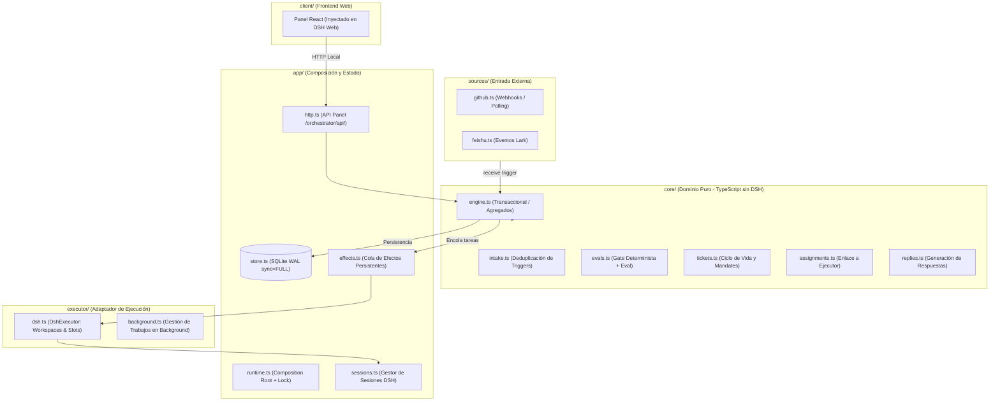
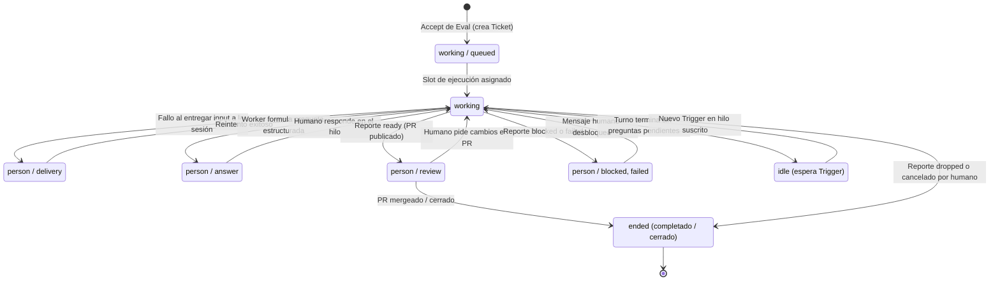

# 02 · dsh-superagent: arquitectura, dominio y ejecución

Esta página analiza la arquitectura, el modelo de dominio y los mecanismos de ejecución de **`dsh-superagent-prototype`** (commit `8c32a9dc`, licencia MIT). El proyecto representa un prototipo de **agente de codificación proactivo** diseñado para operar sobre un único repositorio GitHub (y opcionalmente Feishu/Lark).

!!! info "Filosofía rectora"
    *«Tomar la menor atención humana posible y dar el mayor valor posible»* (`docs/000-philosophy.md:3-5`). El agente actúa únicamente si una persona autorizada se lo pide o una regla escrita del equipo lo permite; habla solo cuando alguien debe actuar o puede utilizar un resultado terminado.

---

## 1. Arquitectura en capas

El diseño sigue un patrón hexagonal de puertos y adaptadores con separación estricta entre el dominio de negocio (puro e independiente) y los adaptadores de infraestructura (`docs/007-architecture.md:5-25`):

La arquitectura se articula en torno al `Engine` (`src/core/engine.ts:46-52`), que es síncrono y transaccional: cada comando muta el estado del dominio dentro de una transacción SQLite atómica (`synchronous=FULL`, WAL). La capa `core` no importa librerías de DSH ni de Node.js; los efectos secundarios (lanzar sesiones, enviar mensajes) se difieren a través de la cola duradera `Effects` (`src/app/effects.ts`).

---

## 2. Modelo de dominio

El dominio modela el ciclo de vida del trabajo mediante entidades desacopladas (`docs/001-domain.md:21-45`, `src/core/model.ts`):

- **Source**: Flujo tipado de eventos externos. Descarta eventos del propio bot e ignora mensajes fuera de su ámbito de escucha.
- **Trigger**: Evento inmutable con metadatos del remitente. Es la unidad básica de auditoría e idempotencia.
- **Thread**: Secuencia temporal de Triggers en un canal (ej. Issue `#12` o PR `#45`). Ejecuta como máximo una evaluación a la vez.
- **Eval**: Juicio estructurado en dos capas (Gate determinista + Evaluación de LLM) sobre un lote de Triggers.
- **Mandate**: Autorización inmutable otorgada al aceptar un Ticket. Incluye el alcance permitido, la fuerza y el hash de la versión de política (`policyVersion`).
- **Ticket**: Unidad de trabajo autorizada. Posee ciclo de vida propio (`open` → `ended`), independiente de las sesiones del modelo.
- **Assignment**: Vinculación temporal de un Ticket a una sesión concreta del ejecutor. Un Ticket puede tener múltiples Assignments a lo largo del tiempo.
- **Subscription**: Asociación muchos-a-muchos entre Threads y Tickets para distribución de contexto (*fan-out*).
- **Channel**: Extremo de salida hacia la plataforma externa (respuestas a comentarios o hilos de chat).

### Etapas del Ticket (`ticketStage`)

A diferencia de otros sistemas donde el estado de la tarea coincide con el estado del proceso del agente, el superagente evalúa funcionalmente a quién espera el Ticket en cada momento (`src/core/stage.ts:9-21`):

La máquina de estados ilustra una regla cardinal del sistema: «el turno del modelo terminó» no significa «el trabajo está resuelto». Si el modelo formula una pregunta o reporta un bloqueo, el Ticket entra en estados `person/*`, donde permanece a la espera de una acción humana. Solo el cierre efectivo de los recursos seguidos (como el merge de un PR) conduce a la etapa final `ended`.

---

## 3. Autorización y política de admisión

La seguridad del superagente se apoya en el principio de que **el texto en lenguaje natural nunca puede otorgar autoridad**:

1. **Gate Determinista previo al LLM**: Antes de llamar a ningún modelo de evaluación, el código estático filtra el evento según la matriz de admisión (`src/admission.ts:9-13`). Se cruza el tipo de remitente (listado en la política o no) con la forma del mensaje (mención directa o mensaje no dirigido).
2. **Modos de Operación (`off | observe | auto`)**:
   - `off`: Descarta candidatos proactivos. Solo atiende peticiones explícitas.
   - `observe`: Ejecuta la evaluación pero, si resulta favorable, no abre el Ticket ni escribe al canal; registra un resultado de auditoría `would_accept` para calibración previa al despliegue.
   - `auto`: Modo operativo pleno; los candidatos aceptados inician ejecución.
3. **Suscripción de Contexto vs. Autorización**: Los mensajes que llegan a un hilo ya suscrito se entregan al Ticket activo como contexto (`docs/002-authorization.md:18`). **Nunca otorgan nueva autoridad**. Un comentario de un tercero o un log de CI en un PR no pueden ampliar el alcance del Mandato original.
4. **Inmutabilidad del Mandato**: El Mandato queda fijado a la versión de política activa en el momento de creación (`policyVersion`). Si el administrador modifica la política en caliente, los Tickets activos no se cancelan de forma destructiva; su Mandato simplemente se revalida si el Ticket intenta reanudarse tras un parón.

---

## 4. Ejecución, concurrencia y límites

### La Regla de los 5 Segundos en Shell
En `cordis.patch.yml:44-56`, el preset del trabajador (`dsh-superagent-worker`) configura el plugin `@deepseek-ai/dsh-bash-sandbox` con `timeoutMs: 5000`. Si un comando dura más de 5 segundos (por ejemplo, `npm test` o una compilación), el sandbox lo transfiere automáticamente a segundo plano (`background job`). Esto evita que comandos largos bloqueen la sesión y asegura que nuevos mensajes humanos puedan ser procesados en el siguiente paso (`docs/003-execution.md:27-28`).

### Concurrencia y Prioridad Humana
El sistema implementa un pool de slots de ejecución concurrentes (`src/executor/dsh.ts:57-62`). Para evitar que ráfagas de tareas proactivas saturen la capacidad de cómputo y dejen desatendidos a los desarrolladores, el ejecutor reserva **un slot extra exclusivo para mensajes humanos o solicitudes de estado**.

### Límite de Seguridad Explícito
El propio documento de diseño advierte con total transparencia:
> *«Los wrappers y directorios establecen valores por defecto, no una frontera de seguridad. Un worker puede ejecutar cualquier binario por ruta absoluta.»* (`docs/003-execution.md:80`).

Las sesiones de los trabajadores corren con `danger-full-access` (`src/app/sessions.ts:152`) con el usuario del sistema operativo del operador. Los comandos bloqueados en la configuración son meros shims de conveniencia, no un sandbox de aislamiento real.

---

## 5. Panel de supervisión («needs you» first)

El panel web (`docs/005-panel.md:5-12`) se diseñó bajo la regla de **«Quiet by default»**: si el sistema está operando correctamente, ocupa el mínimo espacio visual posible. Responde estrictamente a tres preguntas por orden de urgencia:

1. **¿Hay algo que me necesite ahora?** (Tickets en etapas `person/*`).
2. **¿Está el sistema sano y haciendo lo correcto?** (Métricas de salud, sincronización de repositorios).
3. **¿Cuál es el historial de una tarea?** (Trazabilidad completa: Trigger → Eval → Ticket → PR).

Para proteger la interfaz local frente a ataques de rebote desde el navegador, la API expuesta en `/orchestrator/api/` solo escucha en `127.0.0.1`, valida las cabeceras `Host` y `Origin`, y exige la cabecera personalizada obligatoria `x-orchestrator-request: 1` (`src/app/http.ts:75,230`).
