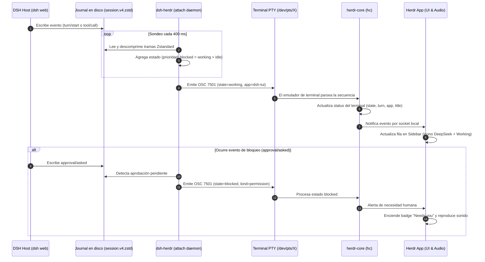

# 03 · dsh-herdr: telemetría, journals y protocolo OSC 7501

Esta página documenta la arquitectura de **`dsh-herdr`** (commit `2d74cf86`, licencia Apache-2.0), una herramienta de monitorización pasiva que hace visibles las sesiones de DeepSeek Harness en la aplicación de terminal [Herdr](https://herdr.dev) a través del protocolo **OSC 7501**.

!!! info "Principio de diseño"
    *Lectura de solo lectura y cero invasión*. `dsh-herdr` no modifica las sesiones de DSH, no envía prompts, no requiere tokens HTTP y no interrumpe el proceso del host (`README.md:9-10`).

---

## 1. Componentes del sistema

| Componente | Rol y Responsabilidad | Ubicación en Código |
|---|---|---|
| **CLI (`bin/dsh-herdr`)** | Ejecutable principal en Node.js (v0.3.0). Implementa los modos `watch`, `attach` y `daemon`. Lee journals, agrega estados y emite OSC 7501 y el documento `agents.json`. | `bin/dsh-herdr:1-149` |
| **`attach`** | Localiza el pseudoterminal (PTY) del host DSH (mediante `/proc/<pid>/fd/1` en Linux o `ps -o tty=` en macOS) e inyecta secuencias de escape directamente en dicho descriptor sin reiniciar DSH. | `bin/dsh-herdr:596-632` |
| **`daemon`** | Demonio supervisor que consulta periódicamente `hc ls/get` para detectar terminales de Herdr ejecutando `dsh` y acoplarles un monitor `attach` automáticamente. | `bin/dsh-herdr:739-860` |
| **Plugin Nativo (`plugin/index.js`)** | Extensión opcional que corre **dentro** del kernel Cordis de DSH. Se suscribe al bus de eventos interno en memoria (`session/event`, `agent/*`) en lugar de leer archivos en disco. | `plugin/index.js:175,827` |
| **Mod `dsh-monitor` (`app/mods/`)** | Componente gráfico en GPUI (`gpui-kit`) para `herdr-app`. Lee periódicamente `agents.json` y dibuja un panel interactivo con la lista de sesiones, turnos y enlaces web. | `app/mods/dsh-monitor/main.js` |

---

## 2. Lectura de journals y agregación de estados

### Decodificación Tolerante de `session.v4.jsonl.zstd`
DSH escribe de forma continua eventos en un diario comprimido con Zstandard (`~/.dsh/sessions/<cwd-slug>/<session-id>/session.v4.jsonl.zstd`). Al ser un archivo al que el host añade contenido activamente (*append-only*), la última trama puede encontrarse incompleta al momento de la lectura.

En `bin/dsh-herdr:394-424`, el monitor lee el archivo completo a memoria e intenta primero `node:zlib.zstdDecompressSync(buffer)`. Si falla por un corte en la cola, activa el decodificador por streaming `createZstdDecompress()` para rescatar todo el prefijo decodificable (`decodePartial`).

### Jerarquía de Estados Agregados
Dado que un host DSH puede albergar decenas de sesiones en paralelo pero Herdr ofrece una única fila para el pane del host, `dsh-herdr` agrega el estado bajo una estricta relación de prioridad (`bin/dsh-herdr:484-518`):

$$\text{blocked} > \text{working} > \text{idle}$$

1. **`blocked`**: Si alguna sesión tiene una aprobación pendiente (`approval/asked` sin `approval/decided`) o una pregunta al usuario (`ask_user_question`, `exit_plan_mode`).
2. **`working`**: Si al menos una sesión tiene un turno en curso (`openTurn === true`). Para evitar que un host colgado parezca eternamente ocupado, turnos sin actividad durante más de 15 minutos se declaran estancados (`staleTurn`, `bin/dsh-herdr:240-242`) y se ignoran. Si hay varias sesiones activas, se añade el sufijo `(+N more)`.
3. **`idle`**: Si ninguna sesión está en turno ni esperando aprobación.

---

## 3. El protocolo OSC 7501 en Herdr

El protocolo OSC 7501 es un estándar abierto de secuencias de escape para terminales emulado por Ghostty y aprovechado por `herdr-core` (`research/herdr-protocol.md`):

```
ESC ] 7501 ; clave=valor(:clave=valor)* BEL|ST
```

### Reglas Críticas del Formato
- **Delimitador estricto**: Los pares clave=valor se separan **exclusivamente por dos puntos (`:`)**. El uso de punto y coma (`;`), espacios o JSON provoca el descarte íntegro del reporte.
- **`app=dsh-tui`**: Identifica al programa. Herdr mapea este valor a la entrada predefinida en `programs.json`, asignándole el nombre formal **"DeepSeek Harness"** y el icono oficial `dsh-tui.svg`.
- **Codificación Base64 estricta**: Los campos `title` y `msg` deben viajar codificados en Base64 estricto UTF-8.
  - Límites de tamaño: `title` $\le 192$ bytes decodificados (256 codificados); `msg` $\le 2048$ bytes decodificados (2732 codificados).
  - *Trampa del parser en Ghostty 0.1.17*: Si un texto no válido contiene caracteres que pertenecen al alfabeto Base64 pero con longitud o relleno inválido (ej. `msg=hello`), `herdr-core` descarta el reporte completo. Por ello se aplica siempre `b64Clamp` (`bin/dsh-herdr:163-176`).
- **Registros Hijos (`id=`)**: El protocolo admite hasta 255 subregistros por terminal usando la clave `id=segmento/hijo`, permitiendo reportar estados detallados de subagentes o procesos secundarios.

### Semántica de Estados en la Interfaz de Herdr
En `herdr-app`, la distinción entre `done` e `idle` no corresponde a dos palabras distintas emitidas por el agente, sino a una **distinción de atención humana** (`research/herdr-protocol.md:186-218`):
- Cuando un agente pasa de `working` a `idle` o `done`, `herdr-core` incrementa el contador `turn`.
- Si el usuario **no está mirando** esa terminal (`turn > seen_turn`), Herdr muestra la insignia verde **Done** y hace sonar la campana de finalización.
- En cuanto el usuario enfoca la terminal, la interfaz transiciona automáticamente a **Idle**.

---

## 4. Flujo de telemetría de extremo a extremo

El siguiente diagrama de secuencia describe el flujo completo desde que DSH ejecuta una acción hasta que la interfaz de Herdr refleja el cambio:



La secuencia muestra cómo `dsh-herdr` desacopla por completo la ejecución de la observación. A través del sondeo continuo cada 400 milisegundos, el monitor convierte un archivo pasivo en disco en eventos interactivos de terminal, logrando que el sistema de alertas de Herdr reaccione ante las tareas del agente sin requerir integración invasiva dentro del host DSH.
