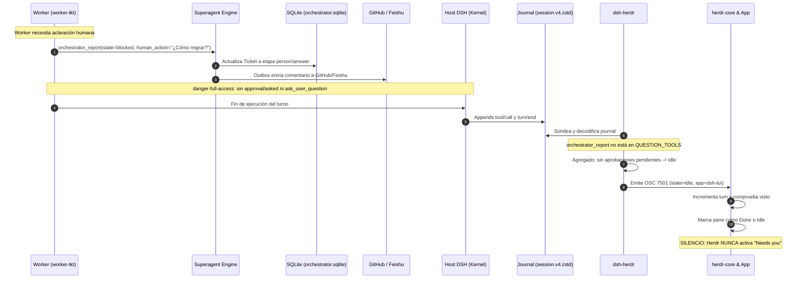
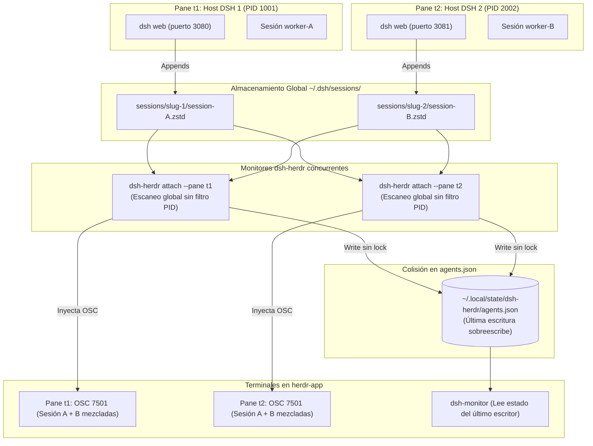

# 04 · Interacción entre superagent y dsh-herdr: puntos de contacto y huecos

Esta página analiza en profundidad qué sucede cuando `dsh-superagent-prototype` y `dsh-herdr` se encuentran en el mismo entorno de ejecución. Expone los puntos de contacto reales, los hallazgos singulares derivados del análisis de código y las fallas de integración silenciosas descubiertas.

!!! info "Fuente de verdad"
    Basado en la síntesis de análisis independiente sobre DSH (2026-11-08). Todas las afirmaciones sobre el comportamiento conjunto son inferencias fundamentadas en lectura estática comparada del código de ambos repositorios, dado que no existe un entorno en vivo donde ambos coincidan.

---

## 1. El mito de la integración: dos proyectos independientes

Un análisis estático exhaustivo demuestra de forma unánime que **`dsh-superagent` y `dsh-herdr` no se conocen**:
- En `dsh-herdr` no existe ni una sola referencia a `superagent`, `tickets`, `mandates` o `evals`.
- En `dsh-superagent` no existe ninguna mención a `herdr`, `7501` o `dsh-tui`.

Ambos coinciden únicamente a través de las convenciones de DeepSeek Harness: los diarios `session.v4.jsonl.zstd` y el bus de eventos del microkernel Cordis.

---

## 2. Matriz de visibilidad: qué vería Herdr en cada situación

Si el superagente corre dentro de un host DSH monitorizado por `dsh-herdr`, la interfaz de Herdr respondería de la siguiente forma ante cada estado del ciclo de vida del Ticket:

| Situación real en dsh-superagent | Estado interno en superagent | Lo que lee dsh-herdr | Lo que muestra Herdr | Diagnóstico de integración |
|---|---|---|---|---|
| **Worker ejecutando tarea** | Etapa `working` | `turn/start` abierto, tool calls (`bash`, `edit`) | Fila con icono DeepSeek, badge **Working**, actividad de herramientas y sufijo `(+N more)` si hay varias sesiones | **Funciona**: Visibilidad adecuada del esfuerzo de computación en curso. |
| **Worker pide ayuda humana** | Etapa `person / answer` o `person / blocked` (`orchestrator_report.human_action`) | `tool/call: orchestrator_report` seguido de `turn/end` | Transición a **Done** (si no se mira) o **Idle**. **Nunca enciende "Needs you"** | ❌ **Hueco crítico**: La solicitud humana queda silenciada en Herdr. |
| **Pull Request listo para revisión** | Etapa `person / review` (reporte `ready`) | `turn/end` de la sesión del worker | Fila en **Done** / **Idle** | ⚠️ **Ceguera de dominio**: Herdr no sabe que hay un PR esperando aprobación. |
| **Comando en segundo plano tras fin de turno** | Etapa `working` (conserva slot hasta 30 min) | `turn/end` registrado en el journal | Fila marcada como **Idle** aunque el proceso siga corriendo | ⚠️ **Desincronización temporal**: El superagente lo considera ocupado; Herdr lo ve libre. |
| **Ticket finalizado por merge en GitHub** | Etapa `ended` (cierre de hilo) | No genera eventos en la sesión worker | Sin cambio en Herdr | Inocuo: la sesión de DSH ya estaba inactiva. |

---

## 3. El gran hueco semántico: el silenciamiento de «Needs You»

El fallo más relevante entre ambos sistemas radica en cómo conciben la interacción humana:

1. **Cómo lo espera `dsh-herdr`** (`bin/dsh-herdr:226-237`):  
   Para activar `state=blocked:kind=permission|question` en OSC 7501 (lo que enciende la insignia roja de alerta en Herdr), el monitor busca en el journal eventos nativos `approval/asked` (diálogos de confirmación del host) o herramientas interactivas `ask_user_question` y `exit_plan_mode`.
2. **Cómo lo hace `dsh-superagent`** (`src/app/sessions.ts:152`, `src/app/tools/executor.ts:75-100`):  
   - Configura las sesiones de los trabajadores con permisos `danger-full-access`, suprimiendo de raíz cualquier diálogo `approval/asked` de DSH.
   - Cuando el worker necesita aclarar una especificación o reportar un bloqueo, no formula una pregunta de consola; invoca su propia herramienta de dominio `orchestrator_report({ state: 'blocked', human_action: '...' })`.
   - Acto seguido, el turno del modelo concluye limpiamente (`turn/end`). El superagente guarda la pregunta en su base de datos SQLite (`orchestrator.sqlite`), pone el Ticket en etapa `person/answer` y remite un comentario a GitHub o Feishu.
3. **Efecto resultante**:  
   Para `dsh-herdr`, el turno terminó con éxito. Herdr marca el pane como finalizado (`done`) y luego en reposo (`idle`). **El operador de Herdr jamás se entera de que el superagente está atascado esperando su respuesta**, a menos que revise directamente GitHub o abra el panel web propio del superagente.



El diagrama contrasta la bifurcación de estados entre ambos mundos: mientras `dsh-superagent` registra formalmente la necesidad de intervención humana en su base de datos transaccional (`orchestrator.sqlite`) y notifica al canal externo, hacia el host DSH solo ocurre una llamada a herramienta ordinaria y un fin de turno estándar. Al no existir eventos nativos de aprobación (`approval/asked`) ni herramientas del set interactivo de DSH (`ask_user_question`), el monitor `dsh-herdr` clasifica la sesión como en reposo (`idle`). En consecuencia, Herdr solo detecta la conclusión del cómputo y transiciona a `done`/`idle`, silenciando por completo la alerta «needs you» para el operador de terminal.

---

## 4. Hallazgo crítico de infraestructura: zstd multi-frame en Node 22 (E4)

Durante la evaluación empírica del entorno (`SINTESIS.md:91`, hallazgo E4), se descubrió una anomalía de comportamiento en el motor de descompresión de Node.js:

!!! warning "Fallo en descompresión de tramas concatenadas"
    En Node.js v22.22.1, la función síncrona nativa `zstdDecompressSync` aplicada sobre un búfer que contiene **dos tramas Zstandard concatenadas** devuelve únicamente el contenido de la primera trama (`"A\n"` en lugar del esperado `"A\nB\n"`).

### Impacto en `dsh-herdr`
DSH escribe sus journals mediante adición continua de tramas (*appends* independientes). En `bin/dsh-herdr:394-402`:
```javascript
// bin/dsh-herdr:394-402
function decompress(file) {
  return fs.readFile(file).then((buffer) => {
    if (buffer.length === 0) return ''
    try {
      return zstdDecompressSync(buffer).toString('utf8')
    } catch {
      return decodePartial(buffer) // Solo entra si lanza excepción
    }
  }).catch(() => null)
}
```
Como `zstdDecompressSync` no lanza ninguna excepción sino que finaliza silenciosamente tras leer la primera trama, el bloque `catch` **nunca se ejecuta**.

En consecuencia, en entornos con esta versión de Node.js, **el lector de journals de `dsh-herdr` pierde todos los eventos posteriores a la primera trama Zstandard**. Este defecto explica con precisión los 3 fallos observados en la suite de pruebas `runtime.test.mjs` (E2/E3).

---

## 5. Otros hallazgos singulares (§6 de la síntesis)

1. **Rutas de Estado Inconsistentes**:  
   El binario CLI `bin/dsh-herdr` respeta la variable de entorno `$XDG_STATE_HOME` para escribir `agents.json`, mientras que el plugin Cordis (`plugin/index.js:92`) y el mod GPUI (`app/mods/dsh-monitor/main.js:21`) apuntan a la ruta fija `~/.local/state/dsh-herdr/agents.json`. Si coexisten varios productores, compiten bajo la política de que la última escritura sobreescribe a las anteriores.
2. **Escaneo Global de Journals sin Filtrar por PID**:  
   El CLI examina indiscriminadamente todos los subdirectorios bajo `DSH_HOME/sessions` (`bin/dsh-herdr:426,613`). Si un usuario corre múltiples instancias de `dsh web` en terminales distintas de Herdr, cada proceso `dsh-herdr attach` agregará las sesiones de todos los hosts, publicando el mismo estado duplicado en todos los panes.



Este esquema evidencia dos limitaciones arquitectónicas en la gestión multi-host de `dsh-herdr`: primero, la función de descubrimiento inspecciona exhaustivamente todo el árbol `~/.dsh/sessions/` sin restringir las sesiones por el PID del host adjunto, provocando que cada instancia de monitor agregue y reporte la actividad combinada de todos los hosts locales en lugar de la del pane específico. Segundo, ambas instancias compiten por escribir concurrentemente en la ruta compartida `agents.json` sin mecanismos de bloqueo o partición por puerto. Como resultado, la última escritura sobrescribe el documento de estado y ambas terminales reciben telemetría cruzada, desvirtuando el aislamiento visual en Herdr.

3. **Subagentes pueden acaparar la fila**:  
   Aunque el README afirma que los subagentes no ocupan la fila principal (`README.md:149`), el código en `bin/dsh-herdr:488` revela que, si no hay ninguna sesión de nivel raíz activa, un subagente en turno sí se convierte en el titular del estado y del título del pane.
4. **Ausencia de Deep Links al Ticket**:  
   El mod de monitorización `dsh-monitor` carece de enlaces profundos para navegar a un Ticket específico; su interacción se limita a enfocar la terminal del host o abrir la raíz de la web en `http://127.0.0.1:3080`.
