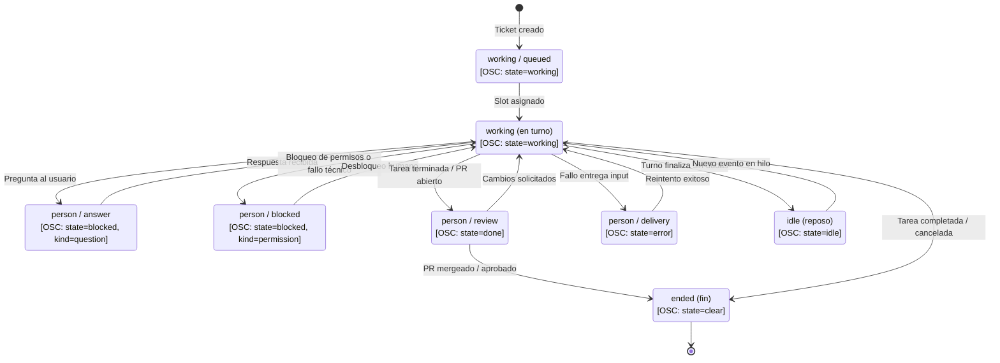
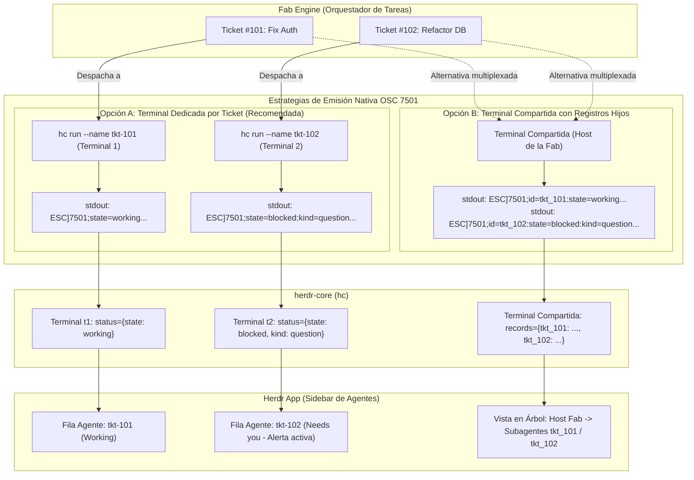

# 05 · Qué tomar de DSH y dsh-herdr para la fab

Esta página sintetiza las lecciones de diseño y patrones arquitectónicos extraídos de **`dsh-superagent-prototype`** y **`dsh-herdr`**, estableciendo una matriz de decisión para la software factory propia (**fab**) y una propuesta técnica concreta para que los agentes de la fab reporten telemetría nativa a Herdr vía OSC 7501.

!!! info "Propuesto (v0.2)"
    Esta propuesta traslada los aciertos conceptuales de ambos proyectos al diseño de la fab. Ninguna de estas piezas está aún integrada en el core de ejecución de fab; constituyen el marco de referencia para la evolución de los adaptadores de agentes (`src/agents.ts`) y la gestión de tareas de la fábrica.

---

## 1. Matriz de decisión: qué tomar y qué no tomar

| Pieza / Patrón | Decisión | Justificación técnica | Evidencia en código upstream |
|---|---|---|---|
| **Criterio de atención mínima** | **Tomar** | Cada notificación o elemento visual debe aportar más valor del que cuesta en atención humana. Si el sistema opera sano, ocupa cero espacio. | `dsh-superagent/docs/000-philosophy.md:3-5` |
| **Gate determinista + Eval de modelo en modo `observe`** | **Tomar** | El código estático valida permisos (quién puede solicitar trabajo); el LLM interpreta el contenido. El modo en sombra permite calibrar sin riesgo. | `dsh-superagent/src/admission.ts:9-13`, `src/core/model.ts:103` |
| **Mandate inmutable separado del contexto** | **Tomar** | Las suscripciones aportan contexto informativo continuo; un comentario externo o log de CI nunca amplía el alcance de autorización original. | `dsh-superagent/docs/002-authorization.md:18` |
| **Ticket independiente de la sesión con etapas `person/*`** | **Tomar** | Desacopla el estado de la tarea del proceso del modelo. Que el turno del agente termine no significa que la tarea esté resuelta. | `dsh-superagent/src/core/stage.ts:9-21` |
| **Outbox + efectos duraderos en SQLite transaccional** | **Tomar** | Garantiza reanudación atómica e idempotencia ante caídas del proceso o reinicios del host sin duplicar mensajes en canales. | `dsh-superagent/src/app/outbox.ts:23`, `src/app/effects.ts` |
| **Shell a background a los 5s + slot humano prioritario** | **Tomar** | Evita que compilaciones o ejecuciones de tests prolongadas retengan la reactividad del agente ante cancelaciones o preguntas del usuario. | `dsh-superagent/cordis.patch.yml:44-56`, `docs/003-execution.md:57-62` |
| **Prompts versionados con registro por sesión** | **Tomar** | Permite auditar exactamente bajo qué versión de instrucciones se ejecutó cada paso histórico de un agente. | `dsh-superagent/src/app/prompts.ts:201` |
| **Panel «¿algo me necesita?» primero** | **Tomar** | Jerarquía de tres preguntas: bloqueos humanos arriba, métricas de salud en medio, historial abajo. Lo sano no distrae. | `dsh-superagent/docs/005-panel.md:5-12` |
| **Emisión nativa de OSC 7501 en agentes de la fab** | **Tomar** | Otorga presencia inmediata en la barra lateral de Herdr, badges dinámicos y alertas sonoras sin requerir servidores HTTP ni dependencias de red. | `dsh-herdr/bin/dsh-herdr:152`, `dsh-herdr/research/herdr-protocol.md` |
| **Registros hijos `id=<ticketId>` o terminal `hc` por Ticket** | **Tomar** (dsh-herdr no lo hace) | Evita el cuello de botella de colapsar la actividad de múltiples tareas concurrentes en una única fila de terminal. | `dsh-herdr/research/herdr-protocol.md` §2 |
| **Journal append-only propio y versionado** | **Tomar el patrón** | Facilita la observación pasiva del sistema sin acoplarse al código de los agentes; requiere evitar trampas de compresión multi-frame. | `dsh-herdr/monitor/lib/sessionlog.mjs:5` |
| **Bridge `attach` mediante inyección en PTY ajeno** | **No tomar** (solo diagnóstico) | Inyectar bytes en `/proc/<pid>/fd/1` es frágil, dependiente de la plataforma y propenso a interferir con terminales interactivas. | `dsh-herdr/bin/dsh-herdr:596-630` |
| **Workers con acceso total como pretendida frontera** | **No tomar** | Otorgar `danger-full-access` y simular aislamiento con shims de comandos bloqueados es una falsa sensación de seguridad. | `dsh-superagent/docs/003-execution.md:80` |
| **Merge gobernado exclusivamente por prompt** | **No tomar** | La política de integración de código debe validarse mediante reglas de plataforma duras (branch protection, linters, tests). | `dsh-superagent/docs/003-execution.md:82-91` |
| **Documento `agents.json` con múltiples escritores sin lock** | **No tomar** | Genera condiciones de carrera donde la última escritura destruye el estado de los productores concurrentes. | `dsh-herdr/bin/dsh-herdr:533-555` |
| **Acoplamiento al framework Cordis y su ModuleLoader** | **No tomar** | Introduce una sobrecarga conceptual masiva innecesaria para una software factory propia construida sobre Node/TypeScript nativo. | `dsh-superagent/package.json:63`, `tsdown.config.ts` |

---

## 2. Propuesta técnica: emisión nativa de OSC 7501 en la fab

!!! info "Propuesto para la fab"
    A diferencia de DSH, los agentes de la fab no deben depender de un monitor externo que intente adivinar si están atascados leyendo archivos en disco. El propio runtime de la fab (o el worker del agente) emitirá **directamente a su descriptor de salida estándar (stdout)** la secuencia de escape OSC 7501 adecuada en cada transición de estado del Ticket.

### Mapeo de Etapas de Dominio a OSC 7501

Para resolver de raíz el «hueco de needs you», las etapas del ciclo de vida del Ticket (`ticketStage`) se traducen formalmente al protocolo de Herdr de la siguiente manera:

```
ESC ] 7501 ; state=<STATE> : app=fab-agent : kind=<KIND> : title=<B64> : msg=<B64> BEL
```

| Etapa interna del Ticket en fab | Estado OSC (`state`) | Subtipo (`kind`) | Título (`title`) | Mensaje de estado (`msg`) | Efecto visual en Herdr |
|---|---|---|---|---|---|
| `working / queued` | `working` | *(omitido)* | `ticket.id` | Base64: «En cola esperando slot» | Badge **Working** en amarillo/azul |
| `working` | `working` | *(omitido)* | `ticket.id` | Base64: actividad de herramienta (ej. `bash: cargo test`) | Badge **Working** animado |
| `person / answer` | `blocked` | `question` | `ticket.id` | Base64: la pregunta concreta formulada por el agente | Badge **Needs you** rojo + Alerta sonora |
| `person / blocked` | `blocked` | `permission` | `ticket.id` | Base64: motivo del bloqueo técnico | Badge **Needs you** rojo + Alerta sonora |
| `person / review` | `done` | *(omitido)* | `ticket.id` | Base64: «PR #N publicado listo para revisión» | Badge **Done** verde hasta que el humano lo revise |
| `person / delivery` | `error` | *(omitido)* | `ticket.id` | Base64: detalle del error de entrega | Badge **Needs you** (error crítico) |
| `idle` | `idle` | *(omitido)* | `ticket.id` | Base64: «En reposo esperando eventos» | Badge **Idle** en gris |
| `ended` | `clear` | *(omitido)* | *(omitido)* | *(omitido)* | Limpieza del registro del agente |



La máquina de estados modela la propuesta para la fab traduciendo cada etapa funcional del Ticket a su correspondiente reporte OSC 7501 en la terminal. A diferencia de DSH, donde el bloqueo humano queda oculto tras el fin de turno, aquí las etapas `person/answer` y `person/blocked` emiten inmediatamente `state=blocked` con subtipos `question` y `permission`, disparando las alertas de Herdr. Asimismo, `person/review` emite `state=done`, manteniéndose verde en la barra lateral hasta que el revisor examine el resultado, y la conclusión definitiva (`ended`) ejecuta `state=clear` para depurar el registro del agente.

### Concurrencia Limpia mediante Registros Hijos (`id=`)

Para evitar que múltiples tareas concurrentes colapsen en una única fila en Herdr (el defecto observado en DSH), la fab puede adoptar dos estrategias complementarias:

1. **Un proceso/terminal `hc` por cada Ticket**:  
   Al lanzar un nuevo Assignment, la fábrica crea un subterminal independiente gestionado por `herdr-core` (`hc run --name <ticketId> ...`). Cada tarea obtiene su propia fila completa en la barra lateral de Herdr con control independiente de foco y logs.
2. **Uso de la clave `id=<ticketId>` dentro de una terminal compartida**:  
   Si varios agentes operan dentro del mismo pane, el reporte utiliza registros hijos:
   ```
   ESC ] 7501 ; id=tkt_01j7 : state=blocked : kind=question : title=... : msg=... BEL
   ```
   Herdr almacena hasta 255 registros hijos en el mapa `records` (`research/herdr-protocol.md` §2), permitiendo que la interfaz represente el árbol completo de agentes de la fábrica sin interferencias destructivas.



La arquitectura propuesta resuelve el colapso de visibilidad multi-agente presentando dos vías de integración limpias: en la Opción A (preferente), cada Ticket corre en su propia sesión de terminal `hc`, obteniendo una fila independiente con su propio ciclo de vida, badges y alertas sonoras sin interferir con otros agentes. En la Opción B, cuando varios agentes comparten un proceso o contenedor común, el runtime emite reportes diferenciados mediante el modificador `id=<ticketId>`, alimentando la tabla de registros hijos de `herdr-core` (hasta 255 entradas). Ambas vías eliminan por completo los sondeos de journals en disco y la inyección en PTY ajenos, garantizando telemetría en tiempo real libre de carreras.
