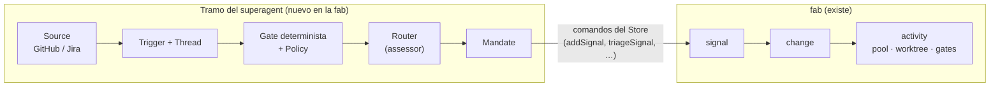
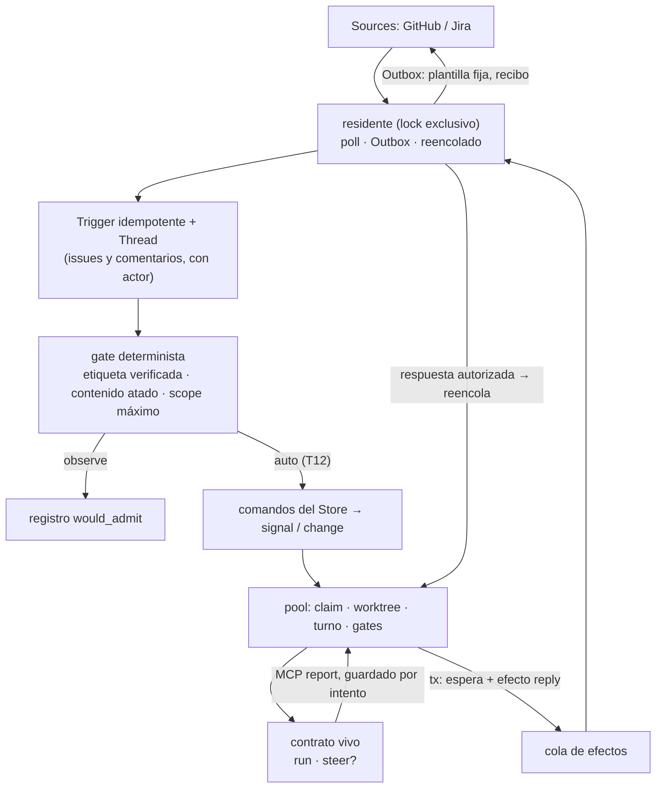
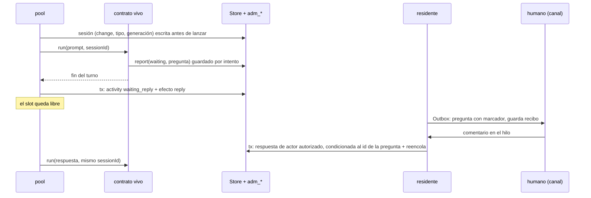

# 06 · Integración del superagent en la fab

Esta página describe cómo incorporar a la fab el tramo que resuelve `dsh-superagent-prototype`: escuchar a un equipo, decidir qué petición se convierte en trabajo y mantener un worker al que se le puede corregir el rumbo. La condición es no duplicar lo que la fab ya tiene y no atarse a un harness.

!!! warning "v0.5: fases 0 y 1 hechas; fase 2 con piezas sin integrar y decisiones por aprobar"
    Diseño revisado en tres rondas EGM con revisores sin contexto:

    - **Ronda 1**: qué le falta a la fab. Fable 5.2, Codex, agy y opencode. Síntesis en `docs/research/superagent-vs-fab/review/SINTESIS-EGM.md`.
    - **Ronda 2**: robustez de lo que la fab ya tiene y estrategia de mitkox. Fable 5.2, Codex con GPT-6-Astra, Pi con Sonnet 5.5, agy y opencode. Síntesis en `docs/research/superagent-vs-fab/review2/SINTESIS-R2.md`.
    - **Ronda 3**: doble check con el código de rc.12 antes de la fase 2. Fable 5.2. Hallazgos en [07 · Ronda 3](07-ronda3-hallazgos-fase2.md); informe en `docs/research/superagent-vs-fab/review3/fable.md`.

    **Estado.**

    - Las fases 0 y 1 están en `release/0.1.0-rc.12`.
    - Las piezas de la fase 2 que pide la ronda 3 (T16-T34) están en el PR #62, todavía **sin integrar en el pool**.
    - Las decisiones de §5.3 están **aprobadas** y el PR #62 las implementa como piezas; falta integrarlas en el pool (T12).
    - Tareas en `docs/research/superagent-vs-fab/task.json`.

Commits de referencia:

| Repo | Commit | Licencia |
|---|---|---|
| fab | `9dbb175` (`release/0.1.0-rc.12`) | — |
| `deepseek-ai/dsh-superagent-prototype` | `8c32a9d` | MIT |
| `mitkox/copilot-superagent` | `693f4db` | MIT |
| `mitkox/esf` | `e5567fb` | MIT |
| `mitkox/dsh-herdr` | `2d74cf8` | Apache-2.0 |
| `deepseek-ai/deepseek-harness` | `fcc0ad4` | MIT |

---

## 1. Dos sistemas que solo se tocan en un punto

| Eje | superagent | fab |
|---|---|---|
| Dominio | Agente proactivo: Trigger, Thread, Eval, Ticket, Assignment | Fábrica de cambios: workstream, signal, change y activity con fases fijas |
| Dueño del estado | `Engine` como única puerta de escritura | `Store` sobre `fabrica.db`; los conectores y la admisión tienen tablas propias (`ChangeLinkStore`, `adm_*`) |
| Ejecución | **Push**: una sesión persistente por Ticket, con `queue`, `steer` e `inject` | **Pull**: un disparo por activity, con lease de 90 s y heartbeat de 30 s |
| Autorización | **Quién** puede originar trabajo: gate, fuerza, Mandate, modo `observe` | **Qué** hace el agente y cuándo avanza: gates humanos, validadores y sandbox |
| Canales | Poll de GitHub y Feishu; Outbox con recibos y reintentos | Jira por clave, a mano; issues de GitHub en modo observe |

Solo se solapan en la **unidad de trabajo aceptada**. La admisión y la conversación, antes de ese punto, son terreno del superagent. Las fases, gates, evidencia y merge, después, son de la fab. Las dos autorizaciones son ortogonales y **se suman**.

Correspondencia de piezas:

| superagent | fab |
|---|---|
| Ticket | change |
| Assignment | un turno: un claim de una activity |
| Sesión `worker-<ticketId>` | sesión por change, tipo de activity y generación (§5.3, S2) |
| Attention (pregunta abierta) | una pregunta abierta por activity, en estado de espera (§5.3, S5) |
| Slots reservados para personas | no hace falta: el claim ordena por `created_at` y una activity reanudada conserva el suyo |

---

## 2. Cómo trabaja mitkox

El mismo autor publica tres piezas alrededor del superagent. Cada una muestra una decisión distinta.

| Pieza | Qué hace | Lección para la fab |
|---|---|---|
| `copilot-superagent` | Port del superagent a VS Code + Copilot SDK. `src/core` se reutiliza; solo cambia la cadena `hostRestarted` (`src/core/reasons.ts:19`). Persistencia, fuentes, worktrees y ejecución se reescriben por host | El dominio es portable; el host y el almacén no |
| `AgentBackend` | `{run, assess, steer?, handoff?, abort, dispose}` (`vscode/src/agent-backend.ts:42-49`). Los métodos opcionales hacen de matriz de capacidades | La forma del contrato vivo. Con un proceso por turno reanudable por id, la fab solo necesita `run` y `steer?` (§5.2, I2) |
| Puerto `Executor` | En copilot, `start`, `deliver` y `stop` **solo encolan un efecto durable** (`vscode/src/runtime.ts:65-73`). Ninguna clase lo implementa contra el harness | El puerto de dominio y el contrato de harness son capas distintas |
| Sesión en copilot | Id estable por ticket; si existe, `resumeSession`, si no, `createSession` con el mismo id. «Un error del proveedor nunca se convierte en sesión nueva» (`vscode/src/copilot.ts:160`). El prompt se reconstruye desde el estado durable (`orchestration.ts:506`) | Regla para la sesión perdida (§5.3, S3) |
| ESF | Factory en Go con Temporal y microVM. Su `Harness {Name, Model, Provision, Run}` equivale a nuestro `AgentAdapter`. El agente nunca se reintenta (`internal/factory/workflow.go:1285-1299`) | Recuperar un lease no autoriza a reejecutar |
| ESF turn service | Un turno con lease, eventos numerados y `execution_id` idempotente; el id de sesión del harness viaja en el checkpoint. Su cliente, «sf», no está publicado | Referencia para una ejecución remota, no para hoy |
| `dsh-herdr` | Observador de solo lectura de los journals de DSH, por OSC 7501 | Herdr queda fuera del camino de control |

Sobre la conexión entre superagent y ESF solo hay un rastro: un worker de ESF sobre la cola Temporal `superagent-esf`, con la config `dsh-superagent-prototype/integration/esf/…`. Aparece en un log de evidencia de otra máquina, y ese directorio no existe en el repo publicado. **No es un precedente verificable.**

---

## 3. Qué tiene ya la fab y cómo de robusto es

| Módulo | Estado en rc.12 | Veredicto | Qué falta |
|---|---|---|---|
| Estado y transiciones | `Store`; change con 10 estados, `blocked` terminal (`src/store.ts:882`) | **Mantener** | Estado de espera conversacional (§5.3, S5) |
| Claim, lease, huérfanos | **Hecho en fase 0**: tope de reintentos al reencolar huérfanos y token por claim (`w<n>-<pid>-<uuid>`) | Hecho | «Resultado desconocido» en activities: existe solo en `adm_effects` (§5.3, S4) |
| Worktrees | **Hecho en fase 0**: `verifyWorktree` comprueba repo, rama y estado; marca `.preparing`. T10 (PR #60): un worktree a medias bloquea y se repara con `fab worktree repair` | Hecho | Ruta truncada a 8 caracteres (T9) |
| Intake | `importIssue` idempotente para Jira, con `withRetry` (fase 0) | **Mantener** | `ExternalRef.system` solo admite `jira`; GitHub entra por la admisión |
| Canal de vuelta | `TicketGateway.comment` síncrono, sin recibo | **Reemplazar** | Outbox sobre la cola de efectos (§5.3, S7) |
| Permisos y sandbox | `bwrap` con `--confine` para `claude`, `codex` y `fake`; en `claude` desactiva MCP y hooks (`src/sandbox/confine.ts:8,58-64`) | **Mantener** | Solo un adaptador confinable para trabajo de canal (§5.3, S8) |
| Adaptadores | `AgentAdapter` de un disparo. **Hecho en fase 0**: prompt por stdin en `claude`, `codex`, `droid` y `native`; `agy` y `fake` siguen por argv | **Mantener + añadir** | Contrato vivo (§5.2, I2) |
| Sesión viva | Existe en `src/agent/rpc.ts` y `src/sdk`, **pero el pool no la usa**: el `native` del pool lanza `fab exec` de un disparo | **Conectar** | Mediante el contrato vivo |
| Prompts y perfil | Huella del perfil por activity | **Mantener** | Delimitar el texto no confiable (T33) |
| Eventos | Tabla `events` con texto libre | **Tipar** | `kind` cerrado e ids de intento y de mensaje |
| Gates y verificación | HEAD verificado, rutas protegidas, `VERDICT` | **Mantener** | Es la fortaleza de la fab |

---

## 4. Qué falta

| # | Pieza | Estado |
|---|---|---|
| 1 | Cola de efectos durable, escrita en la misma transacción que el estado | **Hecho en fase 1** (`adm_effects`, `src/admission/effects.ts`), con `attempt_id` y estado `unknown` |
| 2 | Comando residente con lock exclusivo | **Hecho en fase 1** (`fab resident`, modo `off\|observe`), con `fab resident report` (T11, PR #61) |
| 3 | Admisión: gate determinista con fuerza y `scope_max` | **Hecho en fase 1**, en observe. Solo con etiqueta verificada (D1-D2 de `task.json`) |
| 4 | Contrato vivo por harness | Espigas `feat/live-claude` y `feat/live-native`; sesión, report y recuperación en el PR #62, sin integrar en el pool |
| 5 | Estado de espera, preguntas, respuestas y Outbox | Piezas en el PR #62, sin integrar en el pool |
| 6 | Modo `auto` | Pendiente (T12) |
| 7 | Conversación con router, Mandate y Subscriptions | Fase 3 |

---

## 5. Forma de la integración

**Un módulo de admisión delante de la fab**, en la misma `fabrica.db` y con tablas propias fuera de `Store`. Habla con la fab solo mediante comandos de la capa dueña: crear el signal, observar estados, entregar respuestas y reencolar. Nunca escribe directamente en `activities`. Es el patrón de `ChangeLinkStore` y respeta ADR-0001.

**Decidido: misma base y no una aparte.** El estado y su efecto deben escribirse en una sola transacción. En modo WAL, `ATTACH` no da atomicidad entre dos archivos, así que una base aparte obligaría a reconciliar estados a medias. La contención se gestiona con `withRetry` (`src/store.ts:281-301`) y `busy_timeout = 5000` (`src/store.ts:276`). El riesgo no es que caduque el lease de 90 s: en rc.12, **cualquier** error del latido aborta el turno, incluido un `SQLITE_BUSY` agotado (`src/pool.ts:108-115`). T28 (PR #62) hace que el latido tolere bloqueos pasajeros. El módulo usa tablas con prefijo propio y nunca escribe en las de la fab, para poder separarlo si algún día se ejecuta en otra máquina.

Alternativas descartadas:

- **Proyecto aparte**: duplicaría store, pool, worktrees, gates y adaptadores.
- **Capa externa encima**: mitkox la eligió para ESF porque ESF es remoto y aísla en microVM. La fab es local y comparte proceso y disco, así que esa frontera no compensa. Un backend remoto que solo posea el turno queda como opción futura.

El pool lanza los turnos; el residente solo hace poll, Outbox y reencolado (§5.3, S1):

### 5.1 Sesión reanudable dentro de una activity

Mantener un proceso esperando a un humano bloquearía slots, o lo mataría `requeueOrphans`. «Vivo» significa **reanudable por id**, que es la regla de `resume()` del superagent. Cada paso que cruza una frontera queda en la base, para que una caída no pierda la pregunta ni la respuesta.

Si la sesión no se puede reanudar, el pool abre la generación siguiente con el prompt reconstruido. Ese prompt incluye el de la activity, las preguntas y respuestas guardadas y la orden de inspeccionar el worktree antes de seguir (§5.3, S3).

### 5.2 Decisiones de las rondas 1 y 2

Renumeradas de D1-D5 a I1-I5 en la v0.5, porque D1-D3 ya se usan en `task.json` para las decisiones del gate.

| # | Decisión | Estado en v0.5 |
|---|---|---|
| I1 | `person/*` se deriva del change: `person/review` = `implemented`; `person/blocked` = `blocked`/`failed`/`quarantined`; `person/answer` = activity en espera | Vigente; el estado se llama `waiting_reply` (S5) |
| I2 | **Dos niveles.** (1) El dominio encola efectos durables. (2) Un contrato vivo por harness: `LiveBackend {name, confinable, run, steer?}`, con la cancelación como señal del turno (`live/contract.ts`). `assess` es el router de la fase 3; `handoff` y `dispose` solo tienen sentido con un proceso retenido, que se descartó | **Reducida** desde `{run, assess, steer?, handoff?, abort, dispose}` (H-10) |
| I3 | Una sola tool MCP `report(state, summary, human_action?)`. En modo vivo manda el `report` sobre la línea `STATUS:`, y gana el último válido; sin `report`, el turno se trata como hoy (S6) | Ampliada en la ronda 3 (H-11) |
| I4 | Cada operación del contrato lleva id de intento; el `steer` idempotente por `requestId` se exige solo cuando haya steer | **Reducida**: `assertAuthorized`, prompt versionado y `handoff` dejan de ser condición de la fase 2 |
| I5 | Gate duro fuera del prompt y por adaptador. MCP generado por la fab con lista cerrada y **token por turno**. El gate fija el `scope` máximo con metadatos verificados, y nada posterior puede ampliarlo | Vigente; `scope_max` se aplica al crear el signal (T30) |

### 5.3 Decisiones de la ronda 3

Están implementadas como piezas en el PR #62 y ninguna está integrada en el pool. **Todas están aprobadas (S1 y S2 el 2026-11-11, S3 a S8 el mismo día).** Falta integrarlas en el pool (T12).

S2 deja tres detalles abiertos:

- **Dónde vive la tabla.** Hoy está en `adm_sessions`, del módulo de admisión, aunque la sesión es de la ejecución.
- **Cuándo se marca como lanzada.** Debe marcarse antes de lanzar, no en `onSpawn`.
- **El tope de generaciones.** ¿Se reinicia con `fab retry`?

| # | Decisión propuesta | Por qué | Hallazgo · tarea |
|---|---|---|---|
| S1 | **El pool lanza los turnos.** El residente solo hace poll, Outbox y reencolado. Fuera de la fase 2 quedan `launch`, `deliver` y `stop`; parar ya funciona porque el latido aborta ante un change terminal | La cola de efectos despacha en serie: un turno de 20 minutos lanzado por el residente pararía el poll y el Outbox. Claim, lease, worktree, gates y concurrencia ya viven en el pool | H-09 · T24 |
| S2 | **Una sesión por (change, tipo de activity, generación)**, escrita antes de lanzar, con backend, cwd, modelo y huella del perfil (`adm_sessions`) | La activity no es una clave estable, porque `retryChange` crea otra, y el claim es efímero. La fila antes de lanzar evita perder el id si el pool cae a mitad de turno | H-02 · T17 |
| S3 | **Sesión perdida**: marcar `lost`, abrir la generación siguiente con el prompt reconstruido desde estado durable y escribir un evento. Cuenta para el tope de 3 generaciones. Solo dos causas cuentan como pérdida: la sesión no existe, o cambiaron backend, cwd o modelo. Un error transitorio nunca abre sesión nueva | Regla de copilot. Sin ella, la reanudación falla tres veces y el change queda `failed` con una respuesta humana ya dada | H-03 · T18 |
| S4 | **Turno huérfano**: aplicar el `report` guardado si existe; si no, reanudar con «continúa», no con el prompt inicial | Regla de ESF: recuperar un lease no autoriza a reejecutar | H-04 · T19 |
| S5 | **Estado de espera `waiting_reply`**, con transición condicionada al id de la pregunta y un plazo que termina en `blocked` (`REPLY_TIMEOUT`). Una sola pregunta abierta por activity | `awaiting` ya significa «espera revisión de spec» (`review_status`), y siete puntos del Store no conocían el estado nuevo | H-12, H-16 · T27, T31 |
| S6 | **El `report` es durable**: el handler MCP lo guarda por intento sin tocar la activity, y el pool lo aplica al acabar el turno, en la misma transacción que el efecto `reply` | Aplicarlo a mitad de turno haría fallar el latido y abortar al agente; dejarlo en memoria pierde la pregunta si el pool cae | H-01, H-11 · T16, T26 |
| S7 | **Outbox con política fija**: plantilla, tope de longitud, destino derivado del hilo guardado, menciones neutralizadas, filtro del texto saliente y marcador para reconciliar antes de reenviar | Si no, un issue inyectado puede hacer que la fab publique una credencial en el issue con su propia identidad | H-07, H-14 · T22, T29 |
| S8 | **Autoridad.** La etiqueta ata la admisión al contenido que vio quien la puso: una edición posterior da `edited-after-label`. Solo reanuda una respuesta de un actor con rol triage o superior, posterior a la pregunta. Se descartan los eventos de la propia fab. El trabajo que entra por canal solo se ejecuta con un adaptador confinable | La etiqueta verificaba quién, no qué. Un tercero en un issue público no debe dirigir una sesión con permisos de escritura. `native` no es confinable | H-05, H-06, H-08, H-17 · T20, T21, T23, T32 |

Observaciones abiertas del verificador del PR #62, que conviene cerrar al integrar:

- marcar la sesión como lanzada antes de lanzar, no en `onSpawn`, y comparar `profile_digest`;
- el tope de generaciones no se reinicia con `retryChange`;
- delimitar el texto no confiable también en el prompt reconstruido.

---

## 6. Riesgos

| Riesgo | Mitigación | Estado |
|---|---|---|
| **Inyección (ADR-0007)**: el texto de un issue o de una respuesta llega al agente que escribe código | Etiqueta verificada y atada al contenido; respuesta solo de actores autorizados; texto delimitado en el prompt; permisos fuera del prompt; sandbox obligatorio para trabajo de canal | S8, T33; piezas en el PR #62 |
| **Exfiltración por el Outbox** | Plantilla fija, tope, destino fijo, filtro de secretos | S7. Un secreto codificado (base64, troceado) puede pasar el filtro; el tope lo acota pero no lo impide |
| **Bucle de auto-disparo**: el comentario de la fab crea otro trigger | Filtro de la identidad propia y una admisión por hilo | T23 |
| **Reejecución tras caída**: un turno o un efecto ya hecho se repite | Report guardado por intento, reanudación con «continúa», `attempt_id` y reconciliación por marcador | S4, S6, S7 |
| **Sesión perdida en silencio** | Generación nueva con evento y tope | S3 |
| **Bloqueo pasajero de la base que aborta un turno** | El latido tolera `SQLITE_BUSY` hasta cerca del lease | T28 |
| Huérfanos sin supervisión con un comando residente | Tope de reintentos y token de claim | Hecho en fase 0 |
| Prompt por argv (~128 KiB, visible en la lista de procesos) | Prompt por stdin | Hecho en fase 0 salvo `agy` y `fake`; el token MCP de `claude` sale de argv en T34 |
| Espera sin fin y concurrencia | Plazo de la espera; la concurrencia es por proceso de pool: un pool por workstream | S5 |
| `ExternalRef.system` solo admite `jira` | Ampliar el contrato de conectores | Pendiente |
| Términos de uso para conducir `claude` de forma programática | Sin verificar | Pendiente |

---

## 7. Fases

| Fase | Contenido | Condición de salida | Estado |
|---|---|---|---|
| **0 · Endurecer** | Tope de reintentos en `requeueOrphans`, token por claim, verificación de worktrees, `withRetry` en `importIssue`, prompt por stdin | Tests de cada caso: huérfano recurrente, worktree ajeno o a medias | **Hecho** (#55). Ampliado con T10 (#60) |
| **1 · Costura observe** | Cola de efectos, comando residente con lock, poller de GitHub, Trigger y Thread idempotentes, gate con `would_admit`. No crea changes ni ejecuta agentes | Registros reproducibles de `would_admit` | **Hecho** (#56, #57). Informe de observe en T11 (#61); falta la prueba de días contra un repo con issues |
| **2 · Contrato vivo** | Sesión, report durable, `waiting_reply`, preguntas y respuestas, Outbox, modo `auto` mínimo | Costura completa con fallos inyectados en cada frontera: evento → admisión → turno → pregunta → caída → respuesta → reanudación → gates. Las doce fronteras están en [07 · Ronda 3](07-ronda3-hallazgos-fase2.md) §6 | Piezas en el PR #62; falta aprobar §5.3 e integrar en el pool (T12) |
| **3 · Router** | Router, Mandate y Subscriptions | Solo con un canal real y evidencia de necesidad | — |

---

## 8. Decisiones tomadas

| Decisión | Estado |
|---|---|
| Base de datos | **Decidido: misma `fabrica.db`**, con tablas de prefijo propio (§5). Una base aparte rompe la atomicidad entre el estado y su efecto |
| Alcance de la fase 1 | **Solo `would_admit`, sin modelo**. Hecho |
| Gate de admisión | **Decidido** (D1-D3 de `task.json`): solo con la etiqueta `fab`; la etiqueta cuenta si la puso alguien con rol triage o superior; sin cursor, la primera lectura es del último día |
| Primer adaptador vivo | **Decidido: los dos en paralelo, reanudando por id turno a turno y sin steer**: `claude` en `feat/live-claude`, también confinado, y `native` en `feat/live-native`, con la suscripción ChatGPT. Informes en `docs/research/superagent-vs-fab/live/`. Por S8, el trabajo que entra por canal solo va a `claude` confinado; `native` queda para changes creados a mano |
| Quién lanza los turnos (S1) | **Decidido (2026-11-11): el pool.** El residente solo hace poll, Outbox y reencolado |
| Identidad de la sesión (S2) | **Decidido (2026-11-11): una sesión por (change, tipo de activity, generación)**, escrita antes de lanzar |
| Resto de la ronda 3 (S3-S8) | **Decidido (2026-11-11)** tal como se describen en §5.3. Por S8, `native` queda solo para changes creados a mano |

---

## 9. Procedencia

- Fab leída con el método fab-research (ADR-0008): graft y lectura de tramos. ESF y copilot-superagent también se indexaron con graft. Todos los repos se actualizaron antes de la ronda 2.
- El elefante re-verificó en código:
    - Ronda 1: `src/store.ts:882`, `src/agent/rpc.ts:315-349`, `src/sdk/mcp-server.ts:23-30`, `src/cli.ts:147-150`, `src/sandbox/confine.ts:58-64`.
    - Ronda 2: `src/store.ts:281-301,1096-1102`, `src/worktrees.ts:42`, `src/agents.ts:134-143`, `src/sandbox/confine.ts:8`, `copilot-superagent/vscode/src/runtime.ts:65-73`, `esf/internal/factory/workflow.go:1285-1299` y el log de aislamiento de colas de ESF.
    - Ronda 3: `src/pool.ts:108-115` (el latido aborta ante cualquier error), `src/store.ts:498,623` (`review_status = 'awaiting'`), `live-claude/src/live/claude.ts:28` (el `sessionId` no se guarda), `live-native/src/live/native.ts:35-37` (`confinable: false`) y el gate de la fase 1 (la etiqueta verificaba quién, no qué).
- **Corregido en la v0.5**:
    - las citas y estados que el código de rc.12 desmentía (tabla de `review3/fable.md` §6);
    - el contrato vivo reducido a `run` y `steer?`;
    - quién lanza el turno;
    - el slot reservado, que se retira;
    - la numeración de las decisiones.
- **No verificado**:
    - La caducidad de las sesiones de `claude` y reanudar con otro modelo.
    - Que el autor pueda editar un issue después de la etiqueta. Se infiere de la API; el PR #62 lo cubre con tests y un `gh` falso.
    - La lectura de la config MCP dentro del sandbox con `claude` real.
    - El código real de la integración superagent ↔ ESF.
- Experimento de steer en Claude Code (n=1, Haiku): un mensaje stream-json enviado durante una tool entró en el siguiente paso del mismo turno.
