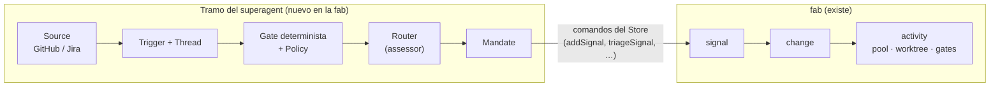
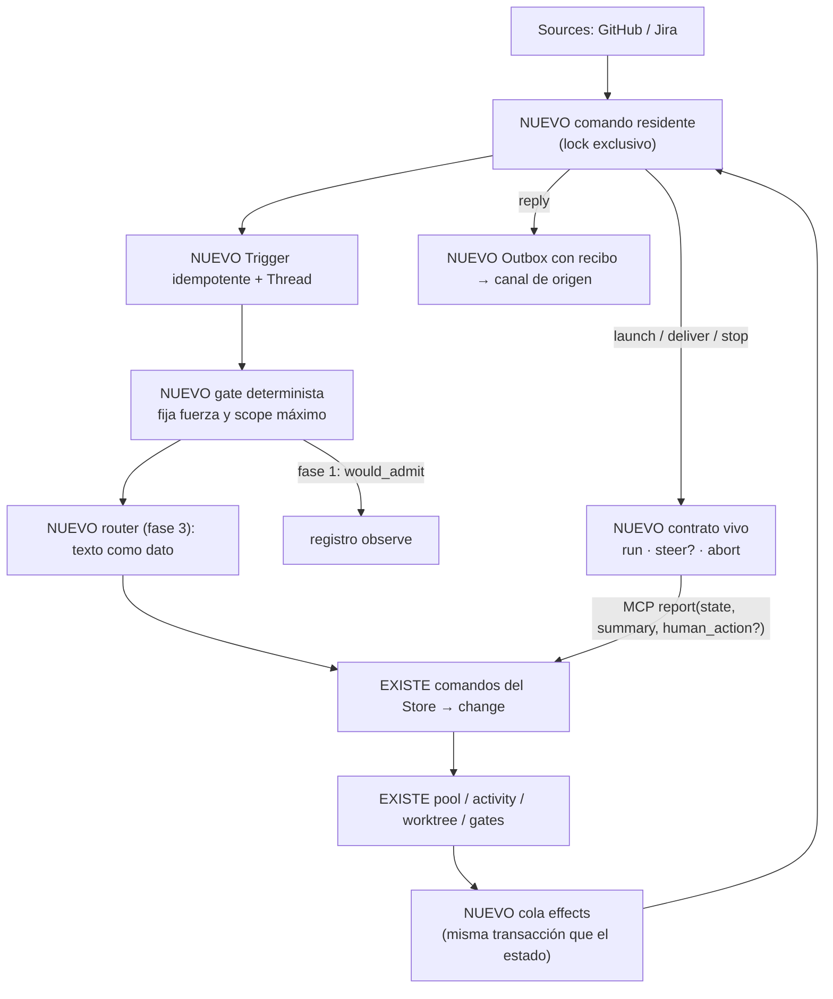
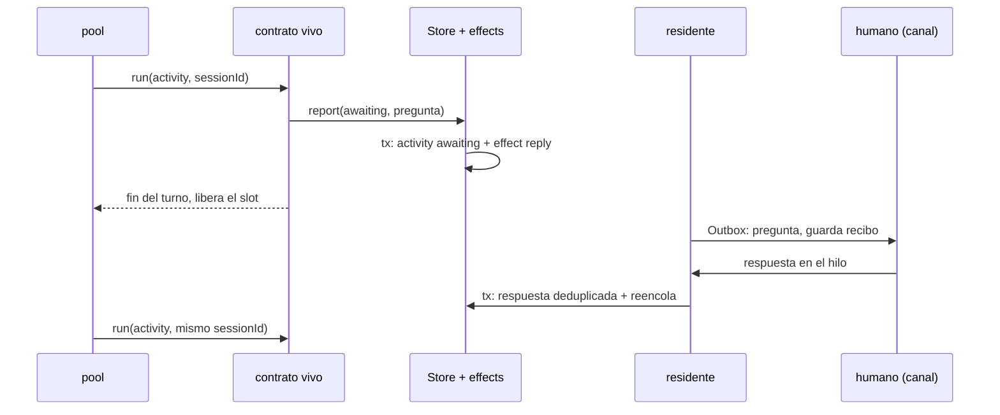

# 06 · Integración del superagent en la fab

Esta página describe cómo incorporar a la fab el tramo que resuelve `dsh-superagent-prototype`: escuchar a un equipo, decidir qué petición se convierte en trabajo y mantener un worker al que se le puede corregir el rumbo. La condición es no duplicar lo que la fab ya tiene y no atarse a un harness.

!!! warning "Propuesto, pendiente de una decisión (v0.4)"
    Diseño revisado en dos rondas EGM con revisores sin contexto.

    - **Ronda 1**: qué le falta a la fab. Fable 5.2, Codex, agy y opencode. Síntesis en `docs/research/superagent-vs-fab/review/SINTESIS-EGM.md`.
    - **Ronda 2**: robustez de lo que la fab ya tiene y estrategia de mitkox. Fable 5.2, Codex con GPT-6-Astra, Pi con Sonnet 5.5, agy y opencode. Síntesis en `docs/research/superagent-vs-fab/review2/SINTESIS-R2.md`.

    No hay código ni ADR todavía. Queda abierta la elección del primer adaptador vivo (§8).

Commits de referencia:

| Repo | Commit | Licencia |
|---|---|---|
| fab | `ce84fc4` | — |
| `deepseek-ai/dsh-superagent-prototype` | `8c32a9d` | MIT |
| `mitkox/copilot-superagent` | `693f4db` | MIT |
| `mitkox/esf` | `e5567fb` | MIT |
| `mitkox/dsh-herdr` | `2d74cf8` | Apache-2.0 |
| `deepseek-ai/deepseek-harness` | `fcc0ad4` | MIT |

---

## 1. Dos sistemas que solo se tocan en un punto

| Eje | superagent | fab |
|---|---|---|
| Dominio | Agente proactivo: Trigger, Thread, Eval, Ticket, Assignment | Fábrica de cambios: workstream, signal, change y activity con fases fijas |
| Dueño del estado | `Engine` como única puerta de escritura | `Store` sobre `fabrica.db`; los conectores ya tienen tablas propias (`ChangeLinkStore`) |
| Ejecución | **Push**: una sesión persistente por Ticket, con `queue`, `steer` e `inject` | **Pull**: un disparo por activity, con lease de 90 s y heartbeat de 30 s |
| Autorización | **Quién** puede originar trabajo: gate, fuerza, Mandate, modo `observe` | **Qué** hace el agente y cuándo avanza: gates humanos, validadores y sandbox |
| Canales | Poll de GitHub y Feishu; Outbox con recibos y reintentos | Jira por clave, a mano; comentario síncrono sin recibos |

Solo se solapan en la **unidad de trabajo aceptada**. La admisión y la conversación, antes de ese punto, son terreno del superagent. Las fases, gates, evidencia y merge, después, son de la fab. Las dos autorizaciones son ortogonales y **se suman**.

---

## 2. Cómo trabaja mitkox

El mismo autor publica tres piezas alrededor del superagent. Cada una muestra una decisión distinta.

| Pieza | Qué hace | Lección para la fab |
|---|---|---|
| `copilot-superagent` | Port del superagent a VS Code + Copilot SDK. `src/core` se copia **intacto**; solo cambia la cadena `hostRestarted` (`src/core/reasons.ts:19`). Persistencia, fuentes, worktrees y ejecución se reescriben por host | El dominio es portable; el host y el almacén no |
| `AgentBackend` | `{run, assess, steer?, handoff?, abort, dispose}` (`vscode/src/agent-backend.ts:42-49`). Los métodos opcionales hacen de matriz de capacidades | Es el contrato vivo que le falta a la fab |
| Puerto `Executor` | En copilot, `start`, `deliver` y `stop` **solo encolan un efecto durable** (`vscode/src/runtime.ts:65-73`). Ninguna clase lo implementa contra el harness | El puerto de dominio y el contrato de harness son capas distintas |
| ESF | Factory en Go con Temporal y microVM. Su `Harness {Name, Model, Provision, Run}` equivale a nuestro `AgentAdapter`. El agente nunca se reintenta (`internal/factory/workflow.go:1285-1299`) | Recuperar un lease no autoriza a reejecutar |
| ESF turn service | Un turno con lease, eventos numerados y `execution_id` idempotente. Su cliente, «sf», no está publicado | Referencia para una ejecución remota, no para hoy |
| `dsh-herdr` | Observador de solo lectura de los journals de DSH, por OSC 7501 | Herdr queda fuera del camino de control |

Sobre la conexión entre superagent y ESF solo hay un rastro: un worker de ESF sobre la cola Temporal `superagent-esf`, con la config `dsh-superagent-prototype/integration/esf/…`. Aparece en un log de evidencia de otra máquina, y ese directorio no existe en el repo publicado. **No es un precedente verificable.**

La fab está hoy en la posición de ESF: un proceso por activity. El hueco real es no tener nada equivalente a `AgentBackend`.

---

## 3. Qué tiene ya la fab y cómo de robusto es

| Módulo | Estado en la fab | Veredicto | Qué tomar |
|---|---|---|---|
| Estado y transiciones | `Store`; change con 10 estados, `blocked` terminal (`src/store.ts:882`) | **Mantener** | Modelo de espera conversacional al estilo de Ticket/Assignment |
| Claim, lease, huérfanos | Claim atómico con exclusión por change | **Endurecer** | Tope de reintentos al reencolar huérfanos; token por claim; estado «resultado desconocido» (regla de ESF) |
| Worktrees | Reutiliza cualquier ruta existente (`src/worktrees.ts:42`) | **Mejorar** | `prepare`/`ticketAt` de copilot: repo, rama, ruta canónica, marcador `.ready` |
| Intake | `importIssue` idempotente para Jira | **Mantener** | Clave genérica `(source, id externo)` antes de GitHub |
| Canal de vuelta | `TicketGateway.comment` síncrono, sin recibo | **Reemplazar** | Outbox sobre cola de efectos (superagent) con reconciliación remota (copilot) |
| Permisos y sandbox | `bwrap` con `--confine` para `claude`, `codex` y `fake`; en `claude` desactiva MCP y hooks (`src/sandbox/confine.ts:8,58-64`) | **Mantener** | Revalidar autoridad antes y después de cada permiso (copilot); prompt por stdin (ESF) |
| Adaptadores | `AgentAdapter` de un disparo, prompt por argv | **Mantener + añadir** | Contrato vivo con la forma de `AgentBackend` |
| Sesión viva | Existe en `src/agent/rpc.ts` y `src/sdk`, **pero el pool no la usa**: el `native` del pool lanza `fab exec` de un disparo (`src/agents.ts:134-143`) | **Conectar** | Mediante el contrato vivo |
| Prompts y perfil | Huella del perfil por activity | **Mantener** | `policyVersion` y `revalidate` solo con admisión automática |
| Eventos | Tabla `events` con texto libre | **Tipar** | `kind` cerrado e ids de intento y de mensaje |
| Gates y verificación | HEAD verificado, rutas protegidas, `VERDICT` | **Mantener** | Es la fortaleza de la fab |

---

## 4. Qué falta

1. **Cola de efectos durable**: `effects(kind, key, payload, attempts, due)`, escrita en la misma transacción que el estado. El Outbox, el lanzamiento, la entrega y la parada son casos de ella.
2. **Comando residente** con lock exclusivo, que despacha esa cola y hace poll de Sources.
3. **Contrato vivo** por harness, con la forma de `AgentBackend`.
4. **Admisión**: gate determinista con fuerza `explicit`/`inferred` y modo `off|observe|auto`. Más adelante, Mandate inmutable.
5. **Conversación y router**, cuando haya un canal real: Thread, Subscriptions sin autoridad y un router que valora todas las peticiones.

---

## 5. Forma de la integración

**Un módulo de admisión delante de la fab**, en la misma `fabrica.db` y con tablas propias fuera de `Store`. Habla con la fab solo mediante comandos de la capa dueña: crear el signal, observar estados, entregar respuestas, pedir stop y recibir reports. Nunca escribe directamente en `activities`. Es el patrón de `ChangeLinkStore` y respeta ADR-0001.

**Decidido: misma base y no una aparte.** El estado y su efecto deben escribirse en una sola transacción. En modo WAL, `ATTACH` no da atomicidad entre dos archivos, así que una base aparte obligaría a reconciliar estados a medias. La contención ya se gestiona con `withRetry` (`src/store.ts:281-301`) y `busy_timeout = 5000` (`src/store.ts:276`). La espera típica es lo que dura la otra transacción; el peor caso son segundos, por debajo del lease de 90 s. Una base aparte tampoco quitaría la contención, porque la admisión escribe en `fabrica.db` de todas formas. El módulo usa tablas con prefijo propio y nunca escribe en las de la fab, para poder separarlo si algún día se ejecuta en otra máquina.

Alternativas descartadas:

- **Proyecto aparte**: duplicaría store, pool, worktrees, gates y adaptadores.
- **Capa externa encima**: mitkox la eligió para ESF porque ESF es remoto y aísla en microVM. La fab es local y comparte proceso y disco, así que esa frontera no compensa. Un backend remoto que solo posea el turno queda como opción futura.

### 5.1 Sesión reanudable dentro de una activity

Mantener un proceso esperando a un humano bloquearía slots, o lo mataría `requeueOrphans`. «Vivo» significa **reanudable por id**, que es la regla de `resume()` del superagent. Cada paso que cruza una frontera queda en la cola de efectos, para que una caída no pierda la pregunta ni la respuesta.

### 5.2 Decisiones

| # | Decisión | Origen |
|---|---|---|
| D1 | `person/*` se deriva del change: `person/review` = `implemented`; `person/blocked` = `blocked`/`failed`/`quarantined`; `person/answer` = activity `awaiting`, con una transición nueva que lleva el comentario | Ronda 1 |
| D2 | **Dos niveles.** (1) El dominio encola efectos durables. (2) Un contrato vivo por harness, `{run, assess, steer?, handoff?, abort, dispose}`, donde un método ausente es una capacidad ausente. Sin `contextTools` ni nada específico de VS Code | Ronda 2; sustituye a `Executor {start, deliver, stop}` |
| D3 | Una sola tool MCP `report(state, summary, human_action?)`, alineada con la línea `STATUS:` | Ronda 1 |
| D4 | Criterios mínimos del contrato vivo: `assertAuthorized` antes y después de cada permiso, prompt versionado reaplicado, `steer` idempotente por `requestId` con reconciliación, entrega aceptada y consumida, `handoff` y abort confirmado. Cada operación lleva id de intento | Ronda 2 |
| D5 | Gate duro fuera del prompt y por adaptador. MCP generado por la fab con lista cerrada y token por activity. El gate fija el `scope` máximo con metadatos verificados, y el router no puede ampliarlo | Rondas 1 y 2 |

---

## 6. Riesgos

| Riesgo | Mitigación |
|---|---|
| **Inyección (ADR-0007)**: el texto de un issue llega al agente que escribe código | El router trata el texto como dato y entrega título y alcance en formato fijo. Esa salida sigue siendo no confiable: el gate fija el `scope` máximo y los permisos quedan fuera del prompt |
| Reejecución tras caída: un efecto ya hecho se repite | Identidad de intento, estado «resultado desconocido» y reconciliación antes de reejecutar |
| Huérfanos sin supervisión con un comando residente | Fase 0: tope de reintentos y token de claim |
| Prompt por argv (~128 KiB, visible en la lista de procesos) | Prompt por stdin en los CLI que lo admitan |
| Cuota de la suscripción con varias sesiones | Presupuesto por workstream y slot reservado para mensajes humanos |
| `ExternalRef.system` solo admite `jira` | Ampliar el contrato de conectores |
| Términos de uso para conducir `claude` de forma programática | Sin verificar |

---

## 7. Fases

| Fase | Contenido | Condición de salida |
|---|---|---|
| **0 · Endurecer** | Tope de reintentos en `requeueOrphans`, token por claim, verificación de worktrees, `withRetry` en `importIssue`, prompt por stdin | Tests de cada caso: huérfano recurrente, worktree ajeno o a medias |
| **1 · Costura observe** | Tabla `effects`, comando residente con lock, poller de GitHub, Trigger y Thread idempotentes, gate con `would_admit`. No crea changes ni ejecuta agentes | Registros reproducibles de `would_admit` |
| **2 · Contrato vivo** | Contrato vivo en un adaptador, `awaiting`, Outbox del canal que se abra | Costura completa con fallos inyectados en cada frontera: evento → admisión → turno → pregunta → caída → respuesta → reanudación → gates |
| **3 · Router** | Router, Mandate y Subscriptions | Solo con un canal real y evidencia de necesidad |

---

## 8. Decisiones

| Decisión | Estado |
|---|---|
| Base de datos | **Decidido: misma `fabrica.db`**, con tablas de prefijo propio (§5). El argumento de agy, el bloqueo por `Atomics.wait`, no compensa: en el peor caso son segundos frente a un lease de 90 s, y una base aparte rompe la atomicidad estado + efecto |
| Alcance de la fase 1 | **Solo `would_admit`, sin modelo** |
| Primer adaptador vivo | **Decidido: los dos en paralelo, reanudando por id turno a turno y sin steer.** Espiga hecha sin integrar en el pool: `claude` en la rama `feat/live-claude`, también confinado, y `native` en la rama `feat/live-native`, con la suscripción ChatGPT. Informes en `docs/research/superagent-vs-fab/live/`. Análisis previo: | Ni `native` ni `claude` tienen sesión en el camino del pool, y los dos necesitan el contrato nuevo. `native` no tiene steer ni admite `--confine`. `claude` tiene steer probado con n=1, pero bajo `--confine` pierde MCP. Hoy cuestan parecido |

---

## 9. Procedencia

- Fab leída con el método fab-research (ADR-0008): graft y lectura de tramos. ESF y copilot-superagent también se indexaron con graft. Todos los repos se actualizaron antes de la ronda 2.
- El elefante re-verificó en código:
    - Ronda 1: `src/store.ts:882`, `src/agent/rpc.ts:315-349`, `src/sdk/mcp-server.ts:23-30`, `src/cli.ts:147-150`, `src/sandbox/confine.ts:58-64`.
    - Ronda 2: `src/store.ts:281-301,1096-1102`, `src/worktrees.ts:42`, `src/agents.ts:134-143`, `src/sandbox/confine.ts:8`, `copilot-superagent/vscode/src/runtime.ts:65-73`, `esf/internal/factory/workflow.go:1285-1299` y el log de aislamiento de colas de ESF.
- **Corregido respecto a la v0.3**: `bwrap` sí envuelve a `claude`; lo que se pierde es MCP. La sesión de `native` no está en el camino del pool.
- **No verificado**:
    - Los escenarios de fallo del token de claim, el pgid reutilizado y el worktree a medias: se infieren del código, sin reproducción.
    - Cómo drena los efectos `orchestration.ts` de copilot.
    - El código real de la integración superagent ↔ ESF.
- Experimento de steer en Claude Code (n=1, Haiku): un mensaje stream-json enviado durante una tool entró en el siguiente paso del mismo turno.
