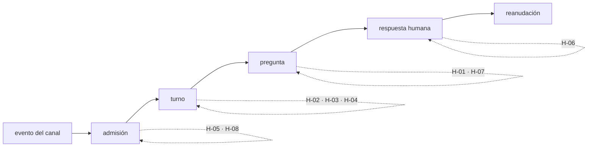

# 07 · Ronda 3: hallazgos antes de la fase 2

Esta página recoge el doble check arquitectónico del diseño [06 · Integración del superagent en la fab](06-integracion-superagent-fab.md), hecho con el código delante antes de empezar la fase 2 (contrato vivo, estado de espera y Outbox).

!!! warning "Veredicto: sí con cambios"
    La forma del diseño aguanta: admisión delante, misma base, cola de efectos y sesión reanudable por id, turno a turno y sin steer. Las fases 0 y 1 están implementadas y son correctas.

    La fase 2 no debe empezar sin cerrar los ocho hallazgos de severidad alta. Ninguno obliga a rehacer lo construido: todos son aditivos.

| | |
|---|---|
| Revisor | Claude Fable 5.2, sin contexto previo y en solo lectura (roles EGM `design_critic`, `zoom_out` y `codebase_details`) |
| Fecha | 2026-11-10 |
| Código revisado | fab `release/0.1.0-rc.12` (`9dbb175`); espigas `feat/live-claude` (`aa9999e`) y `feat/live-native` (`8ad7e55`) |
| Referencias | superagent `8c32a9d`, copilot-superagent `693f4db`, ESF `e5567fb` |
| Informe completo | `docs/research/superagent-vs-fab/review3/fable.md`, con las citas `ruta:línea` de cada afirmación |
| Cola de tareas | `docs/research/superagent-vs-fab/task.json`, tareas T16 a T35 |

Cada hallazgo distingue lo leído en código de lo inferido. Nada se ejecutó: los comportamientos de `claude` y de la API de GitHub que se citan como inferencia no se reprodujeron.

---

## 1. Qué cambia respecto al 06

Cuatro conclusiones corrigen lo que el 06 da por supuesto:

1. **El contrato vivo real es más pequeño que D2.** Las espigas funcionan con `run` y `steer?`; abortar es una señal. `assess`, `handoff` y `dispose` solo tienen sentido con un proceso retenido, que el diseño ya descartó.
2. **El lease de 90 s no mata un turno largo.** El latido es un temporizador del pool, independiente del agente. Lo que corta un turno son los 20 minutos fijos de `runAgent` y cualquier error del latido, incluido un bloqueo pasajero de la base.
3. **El pool debe lanzar los turnos, no el residente.** El 06 dice las dos cosas. La cola de efectos despacha en serie: un turno largo pararía el poll y el Outbox.
4. **El slot reservado para mensajes humanos no hace falta.** El claim ordena por fecha de creación, así que una activity reanudada pasa delante del trabajo nuevo sin reservar nada.

---

## 2. Hallazgos de severidad alta

Bloquean la fase 2 (tarea T12).

| Hallazgo | Tarea | Problema | Qué falla | Propuesta |
|---|---|---|---|---|
| H-01 | T16 | El `report` del agente vive en memoria del pool | El agente pregunta, el pool muere antes de aplicarlo: la pregunta se pierde y el turno se reejecuta | El handler lo guarda por id de intento sin cambiar el estado; el pool lo aplica al acabar el turno, en la misma transacción que el efecto de respuesta |
| H-02 | T17 | El `sessionId` no tiene sitio durable | Tras una caída, el turno siguiente abre una sesión nueva sin memoria. `retryChange` crea otra activity y la pierde | Una fila por change, tipo de activity y generación, escrita antes de lanzar |
| H-03 | T18 | «Sesión irrecuperable» no tiene transición | La reanudación falla tres veces y el change queda `failed` con una respuesta humana ya dada | Generación nueva con el prompt reconstruido desde estado durable, con evento y contando para el tope. Nunca en silencio |
| H-04 | T19 | Un turno huérfano se reejecuta solo | El turno terminó y dejó commits, pero el pool murió antes de cerrarlo: el prompt inicial llega otra vez a la misma sesión | Reconciliar primero y reanudar con un mensaje «continúa», no con el prompt inicial |
| H-05 | T20 | La etiqueta verifica quién autorizó, no qué | Alguien con triage etiqueta un issue inocuo, el autor lo edita con una inyección y el gate vuelve a admitir | Guardar el contenido admitido y exigir que la última edición sea anterior a la etiqueta |
| H-06 | T21 | No se define ni se verifica quién responde en un hilo | Un tercero comenta en un issue público y su texto entra en una sesión con permisos de escritura | Un trigger por comentario, con su actor. Solo reanuda quien tiene rol de triage o superior |
| H-07 | T22 | El Outbox publicaría texto libre del agente | Un issue inyectado hace que el agente lea una credencial y la fab la publique en el issue | Plantilla fija, tope de longitud, destino derivado del hilo guardado y filtro del texto saliente |
| H-08 | T23 | No hay vínculo entre hilo y change, ni filtro de la identidad propia | En modo `auto`, el comentario de la propia fab crea otro trigger y vuelve a admitir | Relación de varios hilos a un change, una admisión por hilo y descartar los eventos de la fab |

---

## 3. Hallazgos de severidad media

Se resuelven dentro de la fase 2.

| Hallazgo | Tarea | Problema | Propuesta |
|---|---|---|---|
| H-09 | T24 | El 06 asigna el lanzamiento del turno al residente y al pool a la vez | Lanza el pool. Fuera `launch`, `deliver` y `stop` de la fase 2 |
| H-10 | T25 | D2 y D4 describen un contrato mayor que el implementado | Reescribirlas desde el contrato de las espigas |
| H-11 | T26 | Hay dos canales de estado, `report` y la línea `STATUS`, sin precedencia | En modo vivo manda el `report`; gana el último válido |
| H-12 | T27 | `awaiting` ya significa «espera revisión de spec», y siete puntos del Store no conocen el estado nuevo | Otro nombre, transición condicionada al id de la pregunta e inclusión en el barrido al cerrar un change |
| H-13 | T28 | Cualquier error del latido aborta el turno | Tolerar bloqueos consecutivos hasta cerca del lease; timeout del turno configurable |
| H-14 | T29 | Los efectos `unknown` y `dead` no tienen salida ni aviso | Marcador en el comentario y reconciliación antes de reenviar; evento visible |
| H-15 | T30 | `scope_max` se calcula y nadie lo aplica | `propose` crea solo el signal; `change` lo lleva a triage |
| H-16 | T31 | La espera no tiene plazo y la concurrencia es por proceso de pool | Plazo que termina en `blocked`; un pool por workstream |
| H-17 | T32 | `native` no es confinable y el 06 lo admite para texto no confiable | Trabajo que entra por canal, solo con un adaptador confinable |

---

## 4. Hallazgos de severidad baja

| Hallazgo | Tarea | Problema | Propuesta |
|---|---|---|---|
| H-18 | T33 | El texto no confiable entra sin delimitar en el prompt | Delimitador con nonce. No sustituye al sandbox |
| H-19 | T34 | El token MCP de `claude` viaja en argv; el efecto de los flags repetidos es solo empírico | Pasar la configuración por archivo y fijarlo con un test |
| H-20 | T35 | Unas quince afirmaciones del 06 ya no coinciden con rc.12 | Actualizar el 06 a v0.5 |

---

## 5. Qué hay que decidir antes de escribir código

En este orden:

1. El pool ejecuta los turnos; el residente solo hace poll, Outbox y reencolado.
2. Canal de la fase 2: comentarios de issues de GitHub, el único con poller.
3. Identidad de la sesión y dónde se guarda.
4. Qué pasa cuando la sesión se pierde.
5. Autoridad del `report` frente a `STATUS`.
6. Cómo se hace durable el `report`.
7. Nombre, transiciones y plazo del estado de espera.
8. Quién puede responder y a qué contenido queda atada la admisión.
9. Qué puede publicar el Outbox.
10. Qué adaptador ejecuta el trabajo que entra por un canal.

---

## 6. Dónde inyectar fallos

La condición de salida de la fase 2 es la costura completa con un fallo en cada frontera. Las dos primeras ya tienen prueba; el resto son nuevas.

| # | Frontera | Qué no debe pasar |
|---|---|---|
| 1 | Leer el canal → registrar el trigger | Duplicar el trigger |
| 2 | Registrar → admitir | Perder la admisión |
| 3 | Admitir → signal creado → efecto cerrado | Duplicar el signal |
| 4 | Claim → sesión escrita → proceso lanzado | Lanzar sin sesión registrada |
| 5 | Pool muerto a mitad de turno con el agente vivo | Dos agentes sobre el mismo worktree |
| 6 | `report` recibido → fin de turno → aplicado | Perder la pregunta |
| 7 | Espera confirmada → envío del comentario | Esperar sin haber preguntado |
| 8 | Comentario enviado → recibo guardado | Publicar dos veces |
| 9 | Respuesta leída → registrada → reencolada | Reencolar dos veces |
| 10 | Reanudar con la sesión perdida | Sesión nueva en silencio |
| 11 | Change cancelado mientras espera | Una activity pendiente bajo un change cerrado |
| 12 | Respuesta duplicada, tardía o de alguien sin rol | Reanudar con ella |

---

## 7. Lo que no se revisó

- `dsh-herdr` y `deepseek-harness`: no se abrieron.
- De superagent, copilot y ESF se leyeron solo los tramos citados en el informe.
- No se ejecutaron tests ni comandos. Son inferencias sin reproducir: la caducidad de las sesiones de `claude`, reanudar con otro modelo, que el autor pueda editar un issue tras la etiqueta y la exfiltración descrita en H-07.
